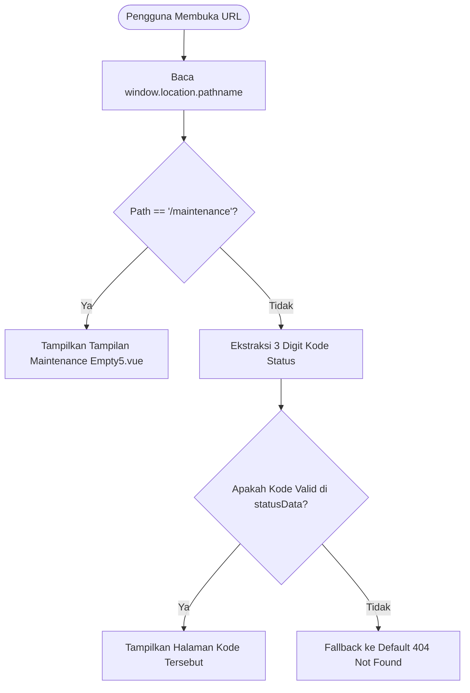

# Dokumentasi Path & Routing — Sainzlab HTTP Status

Dokumen ini berisi panduan lengkap mengenai **URL Routing Paths** (jalur akses web status & maintenance) serta **File/Directory Paths** (struktur direktori & file kode sumber) pada proyek **sainzlab-httpstatus**.

---

## 1. Dokumentasi URL & Routing Paths

Aplikasi ini menggunakan sistem *client-side path detection* berbasis native `window.location.pathname` (tanpa router eksternal berat) dan didukung oleh *SPA fallback* di Nginx untuk mendukung reload dan direct access.

### 1.1 Daftar Path yang Didukung

| URL Path | Kategori | HTTP Title | Tampilan Komponen | Deskripsi Pesan |
| :--- | :--- | :--- | :--- | :--- |
| `/maintenance` | **Maintenance** | Under Maintenance | `Empty5.vue` | Menampilkan ilustrasi server rak data center, animasi status check, tombol *Check Status* dan *Refresh Page*. |
| `/400` | Client Error | Bad Request | `NotFound.vue` | Permintaan ini tidak dapat diproses karena format atau tautannya kurang tepat. Periksa kembali URL Anda lalu coba lagi. |
| `/401` | Client Error | Unauthorized | `NotFound.vue` | Halaman ini memerlukan autentikasi. Silakan masuk dengan akun yang valid untuk melanjutkan. |
| `/403` | Client Error | Forbidden | `NotFound.vue` | Anda belum memiliki izin untuk membuka halaman ini. Hubungi administrator jika menurut Anda ini keliru. |
| `/404` | Client Error | Not Found (Default) | `NotFound.vue` | Halaman yang Anda cari tidak ditemukan. Tautannya mungkin sudah berubah, dipindahkan, atau tidak lagi tersedia. |
| `/408` | Client Error | Request Timeout | `NotFound.vue` | Server membutuhkan waktu terlalu lama untuk merespons. Periksa koneksi Anda lalu coba muat ulang halaman. |
| `/429` | Client Error | Too Many Requests | `NotFound.vue` | Terlalu banyak aktivitas dalam waktu singkat. Mohon tunggu sejenak sebelum mencoba kembali. |
| `/500` | Server Error | Internal Server Error | `NotFound.vue` | Terjadi kendala pada sistem kami. Tim teknis sedang menanganinya—silakan coba lagi beberapa saat lagi. |
| `/502` | Server Error | Bad Gateway | `NotFound.vue` | Komunikasi antarserver kami sedang mengalami gangguan sementara. Silakan muat ulang halaman dalam beberapa saat. |
| `/503` | Server Error | Service Unavailable | `NotFound.vue` | Layanan sedang dalam pemeliharaan atau menangani trafik tinggi. Silakan periksa kembali beberapa saat lagi. |
| `/504` | Server Error | Gateway Timeout | `NotFound.vue` | Server kami belum merespons tepat waktu. Gangguan ini biasanya sementara—silakan coba lagi nanti. |
| `/` *(root)* | Fallback | Not Found (404) | `NotFound.vue` | Default fallback saat path tidak spesifik. |
| `/*` *(lainnya)* | Fallback | Not Found (404) | `NotFound.vue` | Path tidak terdaftar otomatis dialihkan ke status 404. |

---

### 1.2 Cara Kerja Resolusi Path (Path Resolution Logic)

Logika pembacaan path dipusatkan di file `src/components/ui/not-found/statusData.ts` dan dieksekusi di `src/components/ui/not-found/Demo.vue`:



1. **`isMaintenancePath(pathname)`**:
   - Memangkas garis miring awal & akhir (`/maintenance/` -> `maintenance`).
   - Jika nilai sama dengan `"maintenance"`, aplikasi mengaktifkan tampilan pemeliharaan sistem (`Empty5.vue`).
   - Mengubah judul tab browser menjadi: `Under Maintenance | Sainzlab`.

2. **`getStatusFromPath(pathname)`**:
   - Mengambil segmen path dan mengecek apakah sesuai dengan format 3 digit angka (`/^\d{3}$/`).
   - Jika kode terdaftar pada record `statusData` (`400`, `401`, `403`, `404`, `408`, `429`, `500`, `502`, `503`, `504`), data status tersebut akan dimuat.
   - Jika tidak cocok atau mengakses root `/`, otomatis fallback ke kode default `404`.
   - Mengubah judul tab browser menjadi: `<CODE> — <TITLE> | Sainzlab` (contoh: `503 — Service Unavailable | Sainzlab`).

3. **Event Listener `popstate`**:
   - `Demo.vue` memantau navigasi browser (tombol *Back* / *Forward* history) secara reaktif tanpa perlu *full-page reload*.

---

### 1.3 Konfigurasi Web Server & Reverse Proxy (SPA Routing Fallback)

Karena aplikasi adalah Single Page Application (SPA), server harus mengarahkan semua path request ke file `index.html`.

#### Konfigurasi Nginx (tersedia di `Dockerfile`):

```nginx
server {
    listen 80;
    server_name _;
    root /usr/share/nginx/html;
    index index.html;

    # SPA Routing Fallback (mengizinkan akses langsung path seperti /maintenance, /500, /404)
    location / {
        try_files $uri $uri/ /index.html;
    }

    # Error Page Handling
    error_page 500 502 503 504 /index.html;
}
```

---

## 2. Dokumentasi File & Directory Paths (Struktur Proyek)

Berikut adalah peta struktur path file dan direktori pada repositori proyek:

```text
sainzlab-httpstatus/
├── Dockerfile                                 # Multi-stage build Docker (Node.js build + Nginx Alpine runner)
├── index.html                                 # Dokumen HTML utama & font injection (Geist font)
├── package.json                               # Definisi paket, script build, dan dependensi
├── tailwind.config.js                         # Konfigurasi Tailwind CSS, tema Sainzlab, & animasi
├── tsconfig.json                              # Konfigurasi dasar TypeScript
├── vite.config.ts                             # Konfigurasi Vite & alias path '@' -> './src'
│
├── public/                                    # Aset statis publik (dapat diakses via root URL '/')
│   ├── favicon.ico                            # Favicon situs
│   ├── maintenance-server.svg                 # Vektor ilustrasi server rak
│   ├── sainzlab-logo.png                      # Logo Sainzlab versi light
│   └── sainzlab-logo-dark.png                 # Logo Sainzlab versi dark
│
└── src/                                       # Kode sumber utama aplikasi
    ├── App.vue                                # Root component Vue
    ├── main.ts                                # Entry point aplikasi & inisialisasi Vue instance
    │
    ├── assets/                                # Aset lokal & styling
    │   ├── base.css                           # Reset CSS & variabel tema warna dasar
    │   ├── main.css                           # Keyframes animasi fade-in-up, float, pulse
    │   └── sainzlab-logo*.png                 # Varian logo Sainzlab (dark, gold, dual, harmonized)
    │
    ├── components/                            # Direktori komponen Vue
    │   └── ui/                                # Komponen UI modular
    │       ├── animated-theme-toggler/        # Komponen tombol toggle Dark/Light mode dengan view transition
    │       │   ├── AnimatedThemeToggler.vue
    │       │   └── index.ts
    │       │
    │       ├── button/                        # Komponen Button Shadcn/Radix Vue
    │       │   ├── Button.vue
    │       │   └── index.ts
    │       │
    │       ├── empty/                         # Primitif komponen Empty state (Header, Title, Media, Content)
    │       │   ├── Empty.vue
    │       │   ├── EmptyHeader.vue
    │       │   ├── EmptyTitle.vue
    │       │   ├── EmptyDescription.vue
    │       │   ├── EmptyMedia.vue
    │       │   ├── EmptyContent.vue
    │       │   └── index.ts
    │       │
    │       ├── empty5/                        # Komponen khusus halaman Maintenance
    │       │   ├── Empty5.vue                 # Tampilan layout pemeliharaan sistem
    │       │   ├── MaintenanceIllustration.vue# Ilustrasi server interaktif dengan lampu status LED
    │       │   └── index.ts
    │       │
    │       └── not-found/                     # Komponen penanganan HTTP Status Code
    │           ├── Demo.vue                   # Controller utama: mengelola path URL, popstate, switch tampilan
    │           ├── NotFound.vue               # Layout teks status error, tombol navigasi kembali
    │           ├── Illustration.vue           # SVG watermark nomor kode status besar di latar belakang
    │           ├── statusData.ts              # Data katalog kode HTTP, tipe data, & fungsi helper path
    │           └── index.ts
    │
    └── lib/                                   # Fungsi utilitas bersama
        └── utils.ts                           # Fungsi helper 'cn()' (clsx + tailwind-merge)
```

---

## 3. Panduan Pengujian & Akses Path

### Pengujian Lokal (Development):

Jalankan server pengembangan:
```bash
npm run dev
```

Buka URL berikut di browser:
- **Tampilan Maintenance**: `http://localhost:5173/maintenance`
- **Internal Server Error**: `http://localhost:5173/500`
- **Bad Gateway**: `http://localhost:5173/502`
- **Service Unavailable**: `http://localhost:5173/503`
- **Gateway Timeout**: `http://localhost:5173/504`
- **Unauthorized**: `http://localhost:5173/401`
- **Forbidden**: `http://localhost:5173/403`
- **Not Found (Default)**: `http://localhost:5173/404` atau `http://localhost:5173/`

### Pengujian via Container Docker:

```bash
# Build container image
docker build -t sainzlab-httpstatus .

# Jalankan container pada port 8080
docker run -d -p 8080:80 --name httpstatus-test sainzlab-httpstatus

# Uji langsung via browser atau curl
curl -I http://localhost:8080/maintenance
curl -I http://localhost:8080/503
```
